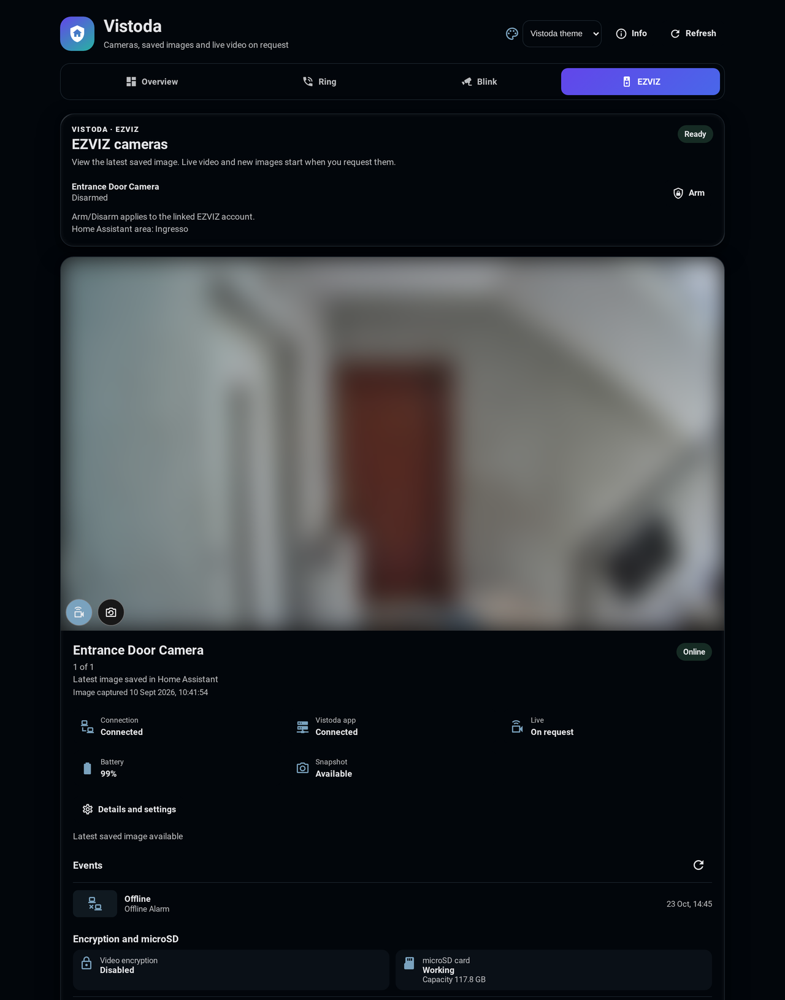
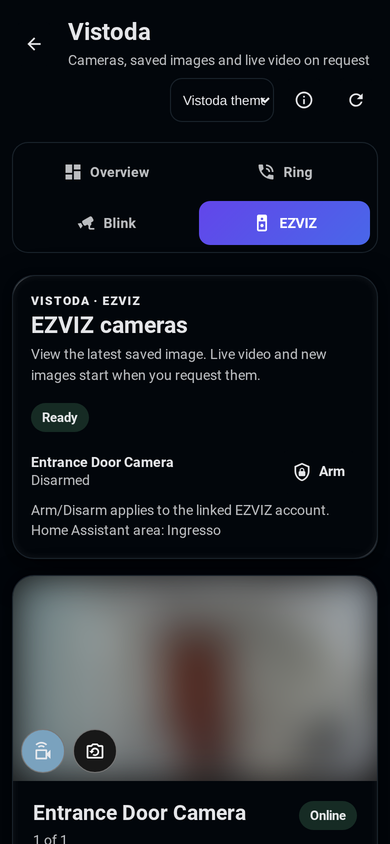

# Vistoda EZVIZ

Vistoda connector for EZVIZ cameras that offer cloud VTM/VTDU media but no RTSP.
One upstream session is shared by bounded, authenticated outputs for Home
Assistant and SceneTrove.

The Rust package and executable stay `ezviz-vtm-bridge` for compatibility; the
product and repository are Vistoda EZVIZ and `vistoda-ezviz`.

The released scope is snapshots, compatible live streams, finite local
recordings, alarms, a read-only microSD status and record index, and native
camera controls that replace Home Assistant's separate `ezviz` login. It does not
provide voice talk or microSD playback, and encrypted-stream compatibility
varies by model. On Home Assistant OS start with the [setup guide](https://github.com/luigibarretta/vistoda-addons/blob/main/GETTING_STARTED.md).

<p align="center">
  
  
</p>
<p align="center"><sub>The Vistoda EZVIZ page in Home Assistant (desktop and phone). Camera images are blurred.</sub></p>

## Why it exists

Some EZVIZ devices (door viewers, battery models) have no local video interface
at all: the vendor cloud is their only stream. This bridge keeps that protocol,
its credentials and failure modes behind a small, versioned HTTP contract.

It does not transcode, record continuously, expose an Internet route or modify
firmware.

## Capabilities

- canonical MPEG-PS (`video/mpeg`) for clear-media cameras and SceneTrove;
- RTP cameras (AES-encrypted H.264/HEVC, or clear) muxed to MPEG-TS in-process
  at the camera's own frame rate, with its AAC audio and no re-encoding;
- complete bounded VTM inventory pagination, exact serial/channel selection and
  optional NVR channel/substream configuration;
- copy-remuxed MPEG-TS (`video/mp2t`) for Home Assistant and media clients;
- fresh JPEG snapshots with short request coalescing;
- read-only alarm feed (cursor/long-poll) with bounded history and pictures;
- automatic encrypted-video detection using an optional private verification
  code or the account's hash-validated cloud copy;
- read-only microSD status and one-day SD record index (no playback, format or
  reboot);
- verified camera controls (switches, defence, detection mode, sensitivity,
  PTZ step) and the account defence mode, cached 60 s (ADR-0021);
- finite media-typed MPEG-PS/MPEG-TS recordings with immutable manifests and
  SHA-256 digests;
- server-paginated archive inventory, private spool metadata and on-demand
  browser MP4 playback;
- one lazy upstream shared by multiple bounded consumers;
- battery protection: hard live-client lifetimes, sessions without media end as
  `camera_offline`, and a 30 s pause before the camera is woken again;
- health and Prometheus metrics without serials, tokens, URLs or media.

## Architecture

```text
EZVIZ VTM/VTDU
      |
      v
native Rust transport -> bounded PS or RTP->TS (audio, own clock) hub -> recordings
                                      |
                                      +-> shared FFmpeg copy-remux -> MPEG-TS
```

The VTM/VTDU wire subset is implemented in safe Rust, with no Python or vendor
SDK. Consumers depend only on [`openapi.yaml`](openapi.yaml). Architectural choices and consequences are
indexed in [`docs/adr/README.md`](docs/adr/README.md).

## Home Assistant OS

Install the main **Vistoda** HACS integration and the **Vistoda EZVIZ** app. Add
the camera serial/channel in the app options before starting it, then complete
the discovered account flow. The [English setup guide](https://github.com/luigibarretta/vistoda-addons/blob/main/GETTING_STARTED.md)
and [guida italiana](https://github.com/luigibarretta/vistoda-addons/blob/main/GETTING_STARTED.it.md)
cover single and multiple cameras, expected results and first checks.

## Standalone development

Docker Compose development, enrollment and canaries are described in the
[operations runbook](docs/OPERATIONS.md#standalone-quick-start).

### Home Assistant app cameras

The Home Assistant app accepts a bounded `cameras` list with 1–64 entries.
Each entry uses a unique alias matching `[A-Za-z0-9_-]{1,64}`, an EZVIZ serial
matching `[A-Za-z0-9]+`, an optional integer `channel` from 1 to 256 (default
`1`), an optional boolean `substream` (default `false`) and an optional private
`verification_code` (4–64 visible ASCII characters, password field):

```yaml
cameras:
  - alias: front-door
    serial: DEVICE123
    channel: 1
    substream: false
    verification_code: ABCDEF  # optional; the label code on the camera
```

The app writes the alias-keyed `cameras.json` contract and publishes one
`media_bridge` discovery device per alias; legacy single-camera options still
work when `cameras` is missing or empty. A verification code is written only to
a mode-0600 file and is used solely as the decryption key: the bridge follows
the camera's cloud encryption flag, so entering the label code on a clear
camera is harmless. **Enter the label code for every encrypted camera.**
Without it, Vistoda asks EZVIZ for the account's copy only when a decryption
needs it, at most once per camera every 24 hours (also across restarts):
that request can make EZVIZ email or text the owner a verification code.
`GET …/encryption` never makes that request.

### Before uninstalling the EZVIZ app

Vistoda does not replace every vendor function. While the official app is
still installed:

1. Note each camera's verification code (the camera label, or the device
   verification-code page in the app's camera settings) and either keep video encryption on and enter the
   code in the Vistoda options, or turn encryption off in the official app.
   Vistoda never changes this setting.
2. Make sure every camera is online, on stable Wi-Fi and on current firmware.
3. Set detection, defence schedules and notification preferences; Vistoda
   reads alarms but does not edit them.
4. Format a new microSD card in the official app and confirm that
   `GET …/storage` reports `ok` and `GET …/sd-records` lists today's clips.
5. Move alerts to Home Assistant automations on the Vistoda alarm feed, then
   disable phone push notifications in the official app if they duplicate.
6. Keep the account credentials; enrollment, sharing, talk, microSD playback
   and recovery still require the official app or its web portal.

## HTTP contract

| Endpoint | Purpose | Authentication |
| --- | --- | --- |
| `GET /healthz` | liveness, version and `ezviz_session` | none |
| `GET /metrics` | low-cardinality metrics | bearer |
| `GET /v1/cameras/{camera}/snapshot.jpg` | JPEG snapshot | bearer or Basic |
| `GET /v1/cameras/{camera}/live.mpegps` | shared MPEG-PS; clear-media cameras only | bearer |
| `GET /v1/cameras/{camera}/live.ts` | shared MPEG-TS | bearer or Basic |
| `GET /v1/cameras/{camera}/alarms?after=&wait=` | alarm cursor/long-poll batch | bearer |
| `GET /v1/cameras/{camera}/alarms/{id}/picture.jpg` | stored alarm JPEG | bearer |
| `GET /v1/cameras/{camera}/encryption` | encryption state and key source | bearer |
| `GET /v1/cameras/{camera}/storage` | microSD status (10-minute cache) | bearer |
| `GET /v1/cameras/{camera}/sd-records?date=` | one-day SD record index | bearer |
| `GET`/`PUT /v1/cameras/{camera}/controls` | cached controls; verified single change | bearer |
| `POST /v1/cameras/{camera}/ptz` | one PTZ step | bearer |
| `GET`/`PUT /v1/account/defence` | account defence mode | bearer |
| `POST /v1/enrollments`, `POST`/`DELETE /v1/enrollments/{id}` | (re-)enroll the EZVIZ account | bearer |
| `POST /v1/cameras/{camera}/recordings` | finite capture | bearer |
| `GET /v1/recordings?page=&page_size=&camera=` | paginated inventory and private spool descriptor | bearer |
| `GET /v1/recordings/{id}` | immutable recording manifest | bearer |
| `GET /v1/recordings/{id}/media` | local MPEG-PS or MPEG-TS declared by manifest | bearer |
| `GET /v1/recordings/{id}/playback.mp4` | fragmented MP4 browser playback | bearer |
| `DELETE /v1/recordings/{id}` | idempotent spool ACK after local commit | bearer |

Basic authentication is reserved for Home Assistant's Generic Camera client:
the fixed username is `homeassistant` and the API token is the password. The
authoritative schemas, bounds and responses are in the OpenAPI document.

Alarms are polled read-only every 15 seconds (`EZVIZ_BRIDGE_ALARM_POLL_SECONDS`,
`0` disables). Omit `after` for up to 50 recent alarms; pass the returned
`next_sequence` as `after` with `wait` ≤ 25 to long-poll new ones. Reset the
cursor when `generation` changes. See [ADR-0018](docs/adr/0018-alarm-event-feed.md).

Control writes need `expected_value` (409 on a stale view), are verified by
read-back and rolled back once on mismatch (502 `unconfirmed`); see ADR-0021.
Reads end within 15 s and may return the last good value with `"stale": true`. 401 means
only a wrong bridge token; a refused EZVIZ session is 403 `reauth_required` (ADR-0022).

## Production model

The canonical deployment is an immutable image pinned by tag and digest,
managed through reviewed Ansible and Portainer configuration. The container
runs as UID/GID `10001`, with a read-only root filesystem, dropped capabilities,
bounded memory/processes and only `/data` writable. It has no public Traefik
route; network access is limited to Home Assistant, SceneTrove and monitoring.

Rust dependencies are frozen in `Cargo.lock` and RustSec-audited. Builder and
runtime base images are pinned by digest; build tooling does not cross into the
runtime. The published image digest is the deployment identity.

## Development and quality gates

Read the family [contribution guide](https://github.com/luigibarretta/vistoda-home-assistant/blob/main/CONTRIBUTING.md)
first to understand repository ownership and cross-repository release order.

Rust 1.88+ and Docker are required:

```bash
cargo fmt --all -- --check
cargo clippy --locked --all-targets --all-features -- -D warnings
cargo test --locked --test loc_budget
cargo test --locked --all-targets
cargo audit --deny warnings
docker build --tag ezviz-vtm-bridge:test .
```

Tests are deterministic and require neither network nor EZVIZ credentials. Live canaries are separate and opt-in. CI enforces formatting, strict Clippy,
tests, RustSec audit, image build and a maximum of 250 physical lines for every
maintained source, configuration and documentation file. Split a responsibility
instead of adding a LOC exception. A repository test also rejects any future
Python source so the Rust-only boundary cannot silently regress.
The Home Assistant bootstrap is vendored from
[`lib-vistoda-provider-kit`](https://git.luigibarretta.com/luigibarretta/lib-vistoda-provider-kit)
at the commit in `dependencies/vistoda-provider-kit.sha` and verified byte-for-byte in CI.

## Security and operations

Never commit credentials, signed URLs, serials, packet captures or video. API
and EZVIZ session tokens belong in mode-0600 files and must not be passed on a
command line. See [`SECURITY.md`](SECURITY.md) for disclosure and rotation
rules, [`docs/THREAT_MODEL.md`](docs/THREAT_MODEL.md) for trust boundaries and
[`docs/OPERATIONS.md`](docs/OPERATIONS.md) for the runbook.

## Project documentation

- [`docs/PLAN.md`](docs/PLAN.md): implementation and verified delivery state;
- [`docs/RESEARCH.md`](docs/RESEARCH.md): protocol research and provenance;
- [`docs/adr/README.md`](docs/adr/README.md): architecture decision records (archive boundaries: ADR-0016);
- [`deploy/`](deploy): sanitized Compose and camera examples.

## License and notices

Copyright 2026 Luigi Barretta. Licensed under Apache-2.0; see [`LICENSE`](LICENSE)
and [`NOTICE`](NOTICE). pyEzvizApi, ezviz_hp7 and LE-EZVIZ-VS are credited as
protocol research and compatibility evidence only; no source is copied or
linked from them.

The encrypted-RTP and full-inventory design was also informed by the
MIT-licensed `Bahrombekk/cloud-cam-viewer` commit pinned in
[`docs/RESEARCH.md`](docs/RESEARCH.md). Vistoda keeps a bounded, on-demand Rust
implementation; it does not adopt permanent camera processes, a one-hour token
cache or Python monkey patches.

## Installation and recovery

Start with the [English setup guide](https://github.com/luigibarretta/vistoda-addons/blob/main/GETTING_STARTED.md)
or [guida italiana](https://github.com/luigibarretta/vistoda-addons/blob/main/GETTING_STARTED.it.md).
The [operations guide](https://github.com/luigibarretta/vistoda-addons/blob/main/OPERATIONS.md)
covers reconnection, updates, rollback, restore and uninstall. The
[compatibility matrix](https://github.com/luigibarretta/vistoda-addons/blob/main/COMPATIBILITY.md)
defines the tested release set and unsupported features.
Images retain licenses/notices under `/usr/share/doc/vistoda`.

## Author, support and independence

Vistoda EZVIZ is maintained by [Luigi Barretta](https://github.com/luigibarretta).
[Support the project on Ko-fi](https://ko-fi.com/luigibarretta). Vistoda is an
independent project; read the shared [disclaimer](https://github.com/luigibarretta/vistoda-home-assistant/blob/main/DISCLAIMER.md)
and [accessibility statement](https://github.com/luigibarretta/vistoda-home-assistant/blob/main/ACCESSIBILITY.md).
